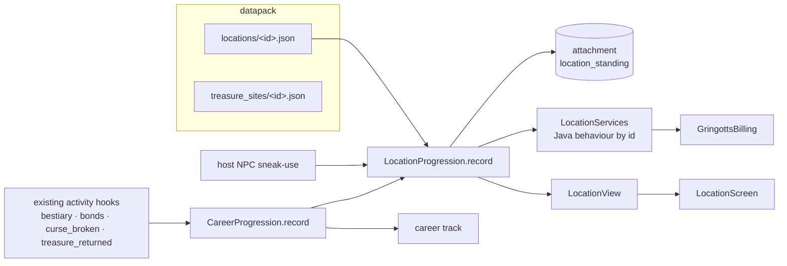

# Locations as gameplay hubs (2026-10-08)

A *location* is a place that gives a player something to do, not a structure. This document covers:

1. the audit of every wizarding place the mod has;
2. the framework (`J/location/`) that turns a place into a hub;
3. Gringotts, the first complete loop, built on that framework;
4. how each remaining place maps onto the framework.

`J/` = `src/main/java/at/koopro/wizardsandbeasts/`, `D/` = `src/main/resources/data/wizards_and_beasts/`.

---

## 1. Audit (verified against the code at `cd45b5bb` + working tree)

| Place | Identity in the world | NPCs / interaction | Services | Activities / progression / reason to return |
|---|---|---|---|---|
| **Gringotts** | Nothing generates. Goblin tellers spawn in dark caves. The `gringotts_` block palette is decorative; the map marks 120+ of it as a landmark. | Goblin teller: papers check, then the vault screen | Vault deposit/withdraw, coin exchange, Dragots | **None before this pass.** A default ward boxed Apparition out of the Overworld origin (P0-1). |
| **Ollivanders** | A villager job (wandmaker) on a craftable bench | Plain use: wand trial or wand care | Trial (first wand free), wand care | None: no standing, no stock that changes, no reason to return beyond a broken wand |
| **Ministry** | Nothing generates. The `ministry_` palette is decorative; standing among it is "inside the Ministry" (`MinistryArea`), which fines trespass | None. Aurors are a distance check, not entities | Licence endorsement (ink + fee) | The Trace, cases and the Wizengamot are real rule logic, but there is no place to visit. Module ships DISABLED. Azkaban sentences never tick. |
| **Azkaban** | Procedural crag + a 5×2×5 placeholder NBT, one per world in deep ocean; module DISABLED | Dementors (real AI, Kiss, Patronus), but no natural spawn source | None | None. Trespasser tag is effectively permanent. |
| **Chamber of Secrets** | A 9×6×9 stone-brick placeholder at Y −40; module DISABLED | Basilisk wakes once per Chamber (`ChamberBasilisk`) | None | A one-time kill for a fang |
| **Hogsmeade / Diagon Alley / Hogwarts** | Decorative palettes only; map markers by block density | None (no vendor, no trades anywhere in the mod) | None | None. No seasonal events. |
| **Travel** | Floo is real and player-run; Portkeys are one-shot; Apparition is real | — | Floo registration fee | No public hearths, no fixed destinations |

**Hooks that already existed**, and which the framework reuses rather than replaces: structure-piece lookup
(`ChamberBasilisk.chamberAt`), landmark density (`MinistryArea.isInside`), host + reach (`GringottsCounter`),
Apparition ward boxes, and the career-track engine (`CareerTrack`, `CareerRules`, `ContractDefinition`): ranks,
experience rules with daily caps, a deterministic daily contract board.

---

## 2. The framework (`J/location/`)



### A location file

```json
{
  "module": "gringotts",               // owning module; off = invisible and inert
  "papers": "ministry_access",         // licence the host checks (optional)
  "skin": "goblin_ledger",             // board's GUI skin (optional)
  "presence": {                        // any form counts
    "hosts": ["wizards_and_beasts:goblin_teller"], "host_reach": 8.0,
    "host_profession": "…",            // villager hosts only
    "landmark": "wizards_and_beasts:landmark/gringotts",
    "structure": "…"                   // worldgen structure id
  },
  "standing": { "ranks": […], "xp_rules": […], "contracts": […] },   // a CareerTrack
  "services": [ { "service": "wizards_and_beasts:appraisal", "min_tier": "customer",
                  "fee_knuts": 58, "discount_per_tier": 0.1, "rate": 0, "rate_per_tier": 0 } ]
}
```

| Piece | Class | Notes |
|---|---|---|
| Definition + loader | `LocationDefinition`, `Locations` | Refuses a file that fails `validate()` or names an unregistered service |
| Presence | `LocationPresence` | host (admitted by the NPC, alive, in reach, right villager trade) · landmark density · structure piece |
| Standing | `PlayerLocationStanding` (attachment `location_standing`, copy on death) | One career `TrackRecord` per place: reputation = xp, tier = rank, board = contracts |
| Engine | `LocationProgression` | Reuses `CareerRules` for reputation caps, contract progress, board, tier-ups. Adds module gate, presence, services, view |
| Services | `LocationService`, `LocationServices`, `ServiceOffer` | Code by id; data sets tier, fee, discount, rate. Fees go through `GringottsBilling` (`MoneyFlow.LOCATION_SERVICE`); without Gringotts a service is free |
| Activity stream | `CareerProgression.record` → `LocationProgression.record` | One call per hook feeds the career **and** every place whose standing reads that activity type |
| UI | `LocationView`, `LocationScreen`, `LocationViewS2CPayload`, `LocationActionC2SPayload` | Server-built view; the client sends intents only (rate-limited); board refreshes in place |
| Hosts | `LocationHostEvents` | Sneak-use on any host opens its board; a plain use keeps the host's old behaviour |

Lang keys are derived from ids: `location.<ns>.<place>.name`, `.tier.<id>`, `.contract.<id>` (+ `.brief`),
`location.<ns>.service.<service>`.

**Adding a place** = one JSON file + lang lines. **Adding a service** = one `LocationService` class registered
in `LocationServices`. **Adding an activity** = one `ActivityType` value + one `CareerProgression.record` call at
the hook — careers and places both see it.

---

## 3. Gringotts — the complete loop

```
teller (sneak-use, or "Bank business" on the vault screen)
  └ board: take an expedition ──► Gringotts chart (vanilla map, X on the nearest site)
      └ tomb chest (desert pyramid · jungle temple · ocean ruins · mansion · ancient city)
          └ cursed artefact (Jinx · Flagrante · Sealing · Withering, 1–4 layers, unread)
              ├ carried: the curse's hazard every 5 s (slow / burn / weak / wither)
              ├ Revelio in hand → read curse + worth   |  or pay the goblins to appraise
              ├ counter-spell in hand → one layer per cast; wrong counter flares
              │    (Finite Incantatem · Glacius · Alohomora · Reparo)
              │    last layer → curse_broken  (+standing, Curse-Breaker career xp)
              └ or pay the goblins to break it (fee or 40 % of worth, less per tier)
  └ surrender clean artefacts → finder's fee 50 % (+6 %/tier) → treasure_returned per site
      → contract completes → coin + standing → tier up
```

| Tier | Standing | Also needs | Unlocks |
|---|---|---|---|
| Customer | 0 | — | desert expeditions, curse practice, bullion; appraisal, curse-breaking, surrender |
| Account Holder | 150 | — | jungle + sunken expeditions; **high-security vault** (27 slots, kept through death, 10 Sickles/week) |
| Trusted Client | 450 | 3 contracts | mansion expeditions, Flagrante specialist, emerald commission |
| Curse-Breaker Associate | 1000 | 3 distinct sites returned, 6 curses broken | **high-value**: the ancient-city hoard (5 Galleons), the Director's diamonds |
| Friend of the Goblins | 2000 | 12 contracts, 15 curses | top rates; 10 Galleons on promotion |

**Reasons to return:** a new board every in-game day (seeded per player), artefacts to bring home, the vault rent,
better rates per tier, the Dragot rate that moves per visit.

**Economy.** New flows: `TREASURE_FINDERS_FEE` and `LOCATION_CONTRACT` (sources), `LOCATION_SERVICE` and
`VAULT_RENT` (sinks). A desert expedition pays ≈ 290 (contract) + ≈ 290 (fee on a 580-Knut artefact) — about one
Curse-Breaker day's wage, for a trip. Delivery contracts turn gold, emeralds and diamonds into coin.

**Gating.** Everything is `Module.GRINGOTTS`: off, the location is inert, no artefact rolls, no hazards tick.
Without the Ministry module the papers check passes, as at the vault.

**Also fixed:** P0-1 — the default `gringotts_vaults` Apparition ward at the Overworld origin is retired, and the
copy each world saved is dropped on load only if it is the exact old box (`RetiredGringottsWardTest`).

### The Curse-Breaker career

`career_tracks/curse_breaker.json` turns the flat Curse-Breaker career into a track fed by the same two activities:
Apprentice → Curse-Breaker → Senior → Master (wage ×1.3/1.7/2.2), with survey contracts that also hand over charts.

---

## 4. Ollivanders — second location, proof the framework is generic

No new engine code: a data file, one service class.

- Host: any villager with the `wandmaker` profession (`host_profession`). Sneak-use opens the board; a plain visit
  keeps the trial and wand care.
- Standing: Patron → Regular → Trusted Supplier → Wandmaker's Friend, earned only through supply contracts
  (unicorn hair, holly, yew, elder wood, a phoenix feather). That is the creature-material outlet the
  Wizard-Life audit asked for (P1-2).
- Service `wand_evaluation`: make, condition, casts, and the wand's history of allegiance — whether it was won,
  and whether someone has been beating its master (which the tooltip never says).

---

## 4b. Traders, the Ministry and the fence (2026-10-08)

The economy pass (`ECONOMY.md`) added a `market` block (and an optional `risk` block) to the location file, three
places and five services, with no change to the engine beyond the market section of the board:

| Place | Host | Module | Notes |
|---|---|---|---|
| `apothecary` | villager `apothecary` (job site: any wizarding cauldron) | gringotts | market (23 bought, 8 sold), creature treatment, supply contracts |
| `ministry` | villager `ministry_clerk` (job site: examination desk) | ministry | Ministry notices, Portkey Office |
| `knockturn_dealer` | wandering trader | ministry | `risk`: every deal may reach the Ministry; smuggling contracts; memory charm, forged papers |
| `ollivanders` | wandmaker | wands | gained a market and wand commissions (broom servicing moved to `broom_shop`) |
| `broom_shop` | broommaker (broom rack) | broom_flight | sells brooms and supplies, broom servicing (2026-10-13) |

A new activity, `goods_traded` (subject: the location), lets a place's standing grow with trade. Contract rewards and
service fees at a place with a `risk` are booked as illicit flows.

## 5. Roadmap for the remaining places

Each row is what the place needs **in the framework's terms**. Blockers come first; the module stays where it is.

| Place | Presence | Hosts / services | Activities to add (one hook each) | Blockers first |
|---|---|---|---|---|
| **Ministry** | `landmark/ministry` (already the trespass rule) | Licence office (endorse, replace a lost scroll), registration (Animagus), hearing desk (answer a summons, pay a fine) — services wrapping `LicenceUpgrade`, `MinistryFines`, `/ministry summons answer` | `LICENCE_ENDORSED`, `CASE_CLOSED`, `FINE_PAID`; Auror contracts count `CASE_CLOSED` | Module DISABLED by design; a Ministry clerk entity (or villager profession) as host |
| **Azkaban** | `structure: azkaban_fortress` | Warden's office: visit a prisoner, deliver evidence, post bail | `PRISONER_VISITED`, `ESCAPE_REPORTED`; Auror investigation contracts | Real fortress NBT (cells, wards, restricted wing at dy 60–80 the patrol goal already expects); Dementor spawn from the structure; Ministry sentences that actually tick (`sentenceTicks` is never set) |
| **Chamber of Secrets** | `structure: chamber_of_secrets` | — (a dungeon, not a shop) | `CHAMBER_ENTERED`, `CHAMBER_PUZZLE_SOLVED`, `BASILISK_SLAIN`; Curse-Breaker / Magizoologist contracts | Real NBT with a hidden entrance, Parseltongue / clue puzzle blocks, hazards; per-Chamber repeat rule already exists (`ChamberBasilisk` slain record) |
| **Diagon Alley / Hogsmeade** | `landmark/diagon_alley`, `landmark/hogsmeade` | Shop services (sell sweets, potion ingredients, robes) with stock that rotates daily; seasonal stock by in-game date | `PURCHASE`, `SEASONAL_EVENT`; relationships = standing per shop file | A shopkeeper host entity or villager profession; a stock/price data type |
| **Hogwarts** | `landmark/hogwarts` | O.W.L. hall (sit/resit — wraps `OWLExaminationHandler`), library | `OWL_SAT` | — |
| **Travel** | Floo hearths as landmarks | Public hearths seeded at hubs; Portkey office service at the Ministry | `FLOO_TRAVEL` | Reserved Floo names |

Generated *hubs* (a hamlet with a teller, a wandmaker and a public hearth) are the remaining piece of
WIZARD_LIFE_AUDIT phase 4. The framework does not need them — a player-built hall of Gringotts marble with a teller
in it already *is* Gringotts — but they would make a default world have one.

---

## Tests

- JUnit: `LocationDataTest` (every location validates, services registered, lang complete, filter subjects are
  real sites/curses, deliveries are real items, every tier reachable), `TreasureRulesTest` (curse arithmetic,
  counters are castable spells, service prices, site data joins), `RetiredGringottsWardTest`.
- GameTests (`LocationTests`): opens at a real teller; presence required; the full expedition loop (read, wrong
  counter, break, surrender, contract, standing); goblin curse-breaking price; vault tier gate, rent and persistence;
  carried hazards; Ollivanders host is the wandmaker only.
