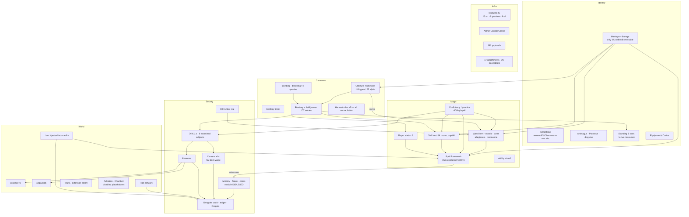

# Wizard-Life RPG Audit — dev @ cd45b5bb (2026-10-08)

This audit asks whether the mod's existing systems join up into a wizard-life RPG, and which connections to build
next. It was read-only. Six system clusters were audited, and every claim was checked against the code, not the
older docs. File references use `J/` for `src/main/java/at/koopro/wizardsandbeasts/` and `D/` for
`src/main/resources/data/wizards_and_beasts/`.

**Verdict.** The systems underneath are unusually deep and mostly server-authoritative. Magic, wands, bestiary,
O.W.L. grading, Apparition and Floo are all real. The game around them is thin, for three reasons:

1. **There is nowhere to go.** A default world generates no wizarding place at all. Azkaban, the Chamber and the
   Ministry modules ship DISABLED, and their structure files are placeholders. "Gringotts" is a goblin that
   happens to spawn in a cave. "Ollivanders" is a villager you convert yourself.
2. **Nothing to buy, little to earn.** There is no shop. The only renewable income is a flat daily career wage,
   and every sink is either a one-off or easy to avoid.
3. **Careers end at the choice.** A career is a label plus one paid act per day. It has no ranks, no work to take
   on and no mastery to reach.

The highest-value work is connective, not more content. That means: a career that turns existing activity
(bestiary, bonding, breeding) into contracts and ranks; material flow from creatures into wands, potions and
coin; and a few reachable places.

---

## A. Current architecture map



**Where state lives:**
- Almost all player state is in attachments with `copyOnDeath`.
- World state is in overworld SavedData: cases, Floo, modules, ledger, ward registry.
- Content is data-driven throughout: spells, creatures, bestiary, skill nodes, wand woods and cores, brooms,
  brews, profiles.
- Two parts are hard-coded: career eligibility and profiles (`J/owl/ProfessionEligibility`,
  `J/owl/career/CareerProfile`).

**Infrastructure:**

| Area | Size |
|---|---|
| Main code | ~258k LOC in 2,226 files; `client/` is 65k |
| Tests | 2,429 JUnit tests and 293 GameTests |
| Systems with **no** tests | trunk, mirror, portkey, effects, loot, SavedData persistence, payload codecs |

---

## B. Gameplay loop map

### Today

| Stage | What a player actually does | Gap |
|---|---|---|
| **Early** (0–1 h) | Heritage ceremony. Find a village, place a bench, take the Ollivander trial. Spend 3 SP on Lumos. Read spellbooks found in chests. | Combat magic depends on loot luck. Wand resonance reads vanilla XP, so every new wizard gets unicorn hair and a rigid wand. |
| **Mid** (1–10 h) | Practise up to 40 casts a day toward tiers and SP. Meet creatures and deepen bestiary pages. Bond a hippogriff, thestral or niffler. Brew. Fly brooms. Learn Apparition. | Most creature drops have no use. Nothing to buy. No places to visit. |
| **Late** (10–30 h) | Sit the O.W.L.s, choose a career, earn a daily wage. Master spells, finish the web. | A career is one act per day. The skill cap fills on its own eventually. |
| **Endgame** | Resit for O grades to reach O-gated careers. | **No endgame.** The Elder Wand cannot be mastered in solo play. Licence ranks buy nothing. Standing gates nothing. |

### Target (built from existing systems)

```
EARLY   identity (heritage, lineage → TRADITION) → wand chosen by who you are (stats, not XP)
        → first spells from the web + found books → first creatures met

MID     practice tiers + bestiary depth + bonds → skill build → O.W.L. revision
        creature materials → wand cores / potions / sale

LATE    O.W.L. → career → RANKS through career work and CONTRACTS
        (Magizoologist: surveys, specimens, husbandry, breeding programmes)
        licences matter (dangerous creatures, restricted substances)

ENDGAME career mastery (Master Magizoologist: Newt's case, rare-creature programmes)
        · legendary wands (Elder Wand via NPC duels) · dragon handling · Ministry standing
```

---

## C. System interaction matrix — should interact, currently do not

Columns: **From → To**, Value (H/M/L), Cost (S/M/L).

| # | From → To | What it would create | Value | Cost |
|---|---|---|---|---|
| 1 | Career → bestiary / bond / breeding | Career progression from work already done (contracts, ranks) | H | M |
| 2 | Creature materials → economy | A buyer for creature parts; income beyond the wage | H | M |
| 3 | Harvest rules → reachable creatures | All 5 rules target creatures that never spawn | H | S |
| 4 | Groom / shed / gift → harvest rules | Non-lethal harvest, in line with the bestiary's own rule | H | M |
| 5 | Dangerous-creature licence → keeping, breeding, riding | The licence is issued but never read | M | S |
| 6 | Trunk sanctuary → bond / breeding / care | Newt's case as a place to keep creatures | H | L |
| 7 | Wand resonance → player stats / practice | "The wand chooses the wizard" by who they are | H | S |
| 8 | Wandlore web / Wandmaker career → bench | Wandmaking skill means something | M | M |
| 9 | Allegiance → NPC duellists | Wand conquest and the Elder Wand in solo play | H | L |
| 10 | Witness attribution → disguise / mask / Hallow | Infiltration and framing | M | M |
| 11 | Animagus offence → evidence-based Trace | Removes the omniscient Ministry | M | S |
| 12 | Standing → gates / prices / careers | Standing finally has a consumer | M | S |
| 13 | Lineage → starting TRADITION | Blood politics as a starting position | L | S |
| 14 | Ministry heat → consequences | Law has teeth: vault lien, Auror pursuit | M | M |
| 15 | Map → Floo hearths / Apparition points | Marker types are declared but never produced | M | S |
| 16 | Apparition wards → landmark palettes | Replaces the hard-coded origin and fake-dimension wards | M | S |
| 17 | Wearable `faction` → anything | Robes as allegiance (house, Death Eater, Auror) | L | S |
| 18 | MinistryPost → owl post | Letters as items, not chat lines | L | M |
| 19 | Proficiency → scribing | A novice can mass-produce spell copies | L | S |
| 20 | OWL career ↔ heritage trades ↔ vocations | Three overlapping "who am I" systems | M | M |

---

## D. Priority list

### P0 — blockers (broken, exploitable, or dead progression)

| # | Issue | Evidence |
|---|---|---|
| P0-1 | ~~Default Apparition ward `gringotts_vaults` covers a 100×80×100 box at overworld origin, which is the spawn area~~ **Fixed 2026-10-08** (`LOCATIONS.md`): default retired, saved copy dropped on load | `J/apparition/ApparitionWardRegistry.java` |
| P0-2 | The Ollivander trial charges and spends the free-wand flag, *then* re-rolls and re-scores, so a bought wand can refuse its buyer | `J/network/wand/ChooseTrialWandPayload.java:50-55` |
| P0-3 | Wand resonance reads vanilla XP level (about 45% of the score), so every new player gets the same wand | `J/wand/resonance/WandResonanceSystem.java:173,211` |
| P0-4 | `teachSpell` bypasses learning eligibility, so the dark_arts tree can be allocated while the module is off, and corruption accrues | `J/skill/SkillSystemAPI.java:376,391` |
| P0-5 | A werewolf bite overwrites the single condition slot, so an Obscurial loses the Obscurus | `J/heritage/HeritageAPI.java:151` |
| P0-6 | Wand-core and material sources are unreachable: troll, thunderbird and wampus never spawn (30 recipes and all 5 harvest rules are dead); snidget (Firebolt) and hidebehind (shadow form) are blocked by `ALPHA_ONLY`; rougarou hair and White River spine have no recipe | creature audit §5 |
| P0-7 | Goblin Dragot arbitrage: 0% fee plus a re-roll every visit gives about +6% per cycle (latent: Goblin is not selectable) | `J/currency/dragot/DragotExchange.java:126`, `J/entity/goblin/GoblinTellerEntity.java:218` |
| P0-8 | `ModuleManager` caches use clear+putAll on a shared EnumMap, which the client and server threads both touch in singleplayer | `J/module/ModuleManager.java:40,92` |
| P0-9 | 98 mod items carry no module tag, so the gate fails open; dark artefacts escape the disabled DARK_ARTS module | infra audit §1 |

### P1 — major gameplay

1. **Career progression with contracts.** Magizoologist as the reference implementation (C1). *Being implemented
   now; see `documentation/PROFESSIONS.md`.*
2. A creature-material outlet (apothecary or Ollivander buyer) and non-lethal harvest (C2–C4).
3. Dangerous-creature licence consumer (C5); trunk sanctuary as a habitat (C6).
4. Wand resonance from stats; bench gated by Wandlore (C7–C8).
5. *(Framework + Gringotts/Ollivanders hubs built 2026-10-08, `documentation/LOCATIONS.md`.)* One reachable wizarding place: real Azkaban and Chamber NBTs (the Chamber made unique), or a generated hamlet
   with a wandmaker, a public hearth and a cache.
6. Law with consequences: vault lien for fines, sentences actually served, witnesses for the Animagus offence
   (C11, C14). Fix revocation laundering through a resit (`J/owl/career/CareerPapers.java:45`).
7. NPC duellists for allegiance and the Elder Wand (C9).
8. Polyjuice survival sample source; witness attribution (C10).

### P2 — important polish

- Character Sheet rows for O.W.L. results, licences and Animagus registration.
- Map markers (C15) and ward data (C16).
- Standing gates shipped (C12).
- A Patronus that matches the Animagus form.
- Fire `FIRST_ANIMAGUS_TRANSFORMATION`.
- Seed TRADITION from lineage (C13).
- A cost or cooldown on vocation commits.
- Split Config into CLIENT and SERVER specs.
- Payload codec round-trip tests.
- A single schema version for SavedData.

### P3 — optional

- House and Sorting tied to robes and banners.
- Quidditch.
- Merge the widget kits and palettes.
- Remove dead data: unused effect components, core temperament fields, `ability_refinement`, Proficiency
  multipliers.
- Update stale docs: SKILL_WEB, KNOWN_ISSUES §4c/§5, DEAD_END_AUDIT, MULTIPLAYER_AUDIT:47, CURRENT_STATE:156.

---

## E. Recommended roadmap (dependency-aware)

| Phase | Scope | Depends on | Why this order |
|---|---|---|---|
| **0. Stabilise** | P0-1…P0-9 | — | Small, local fixes. Each one is broken for a default player now. |
| **1. Career spine** | Profession tracks: ranks, career XP, contracts, milestones, mastery, Career tab. Magizoologist end to end. | existing careers, bestiary, bond | Gives every later system a consumer. *In progress.* |
| **2. Material flow** | Reachable sources (P0-6), non-lethal harvest, a material buyer, creature ingredients in brews | 1 (contracts can request specimens) | Makes creatures feed wands, potions and coin |
| **3. Licences with meaning** | Dangerous-creature licence for keeping and breeding; licence ranks read by gates; lost-scroll replacement | 1, Ministry module | Turns paperwork into decisions |
| **4. Places** | Unique Chamber, real Azkaban, one generated wizarding hamlet; wards from palettes; map markers | 0 | Gives travel and exploration a destination |
| **5. Second and third careers** | Healer/Potioneer (brew contracts), Wandmaker (commissions); then Auror once law has teeth (6) | 1, 2 | Data plus new activity hooks only |
| **6. Law with teeth** | Vault lien, served sentences, evidence-based Animagus offence, witness attribution | 3, 4 (Azkaban) | Makes the Auror career and a criminal path playable |
| **7. Endgame** | NPC duellists, Elder Wand hunt, dragon handling, career mastery capstones | 1–6 | Long-term goals built from the systems above |

**Do not** (consistent with `SYSTEM_INTERACTION_MAP.md` §5): sell spells, let a career multiply spell power, or
pay per act instead of per working day.
